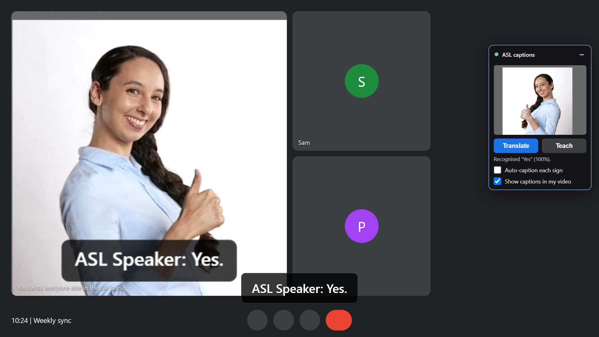
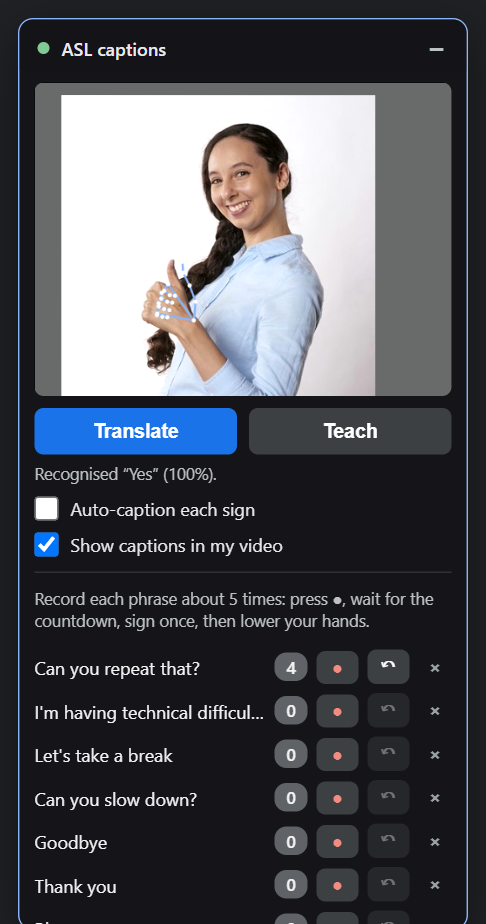
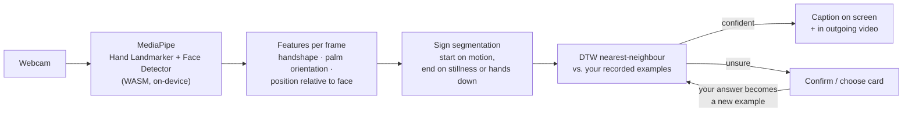
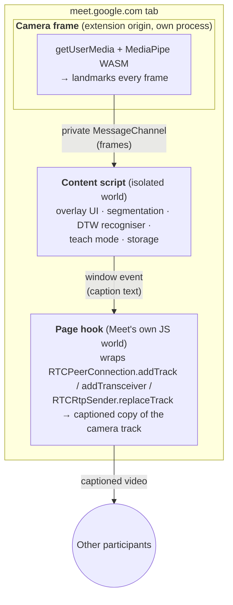

<div align="center">

# 🤟 ASL Meeting Captions

**Real-time American Sign Language captions for Google Meet, running entirely in the browser.**

A Chrome extension that watches a signer's hands through the webcam, recognises the signed phrase, and puts it on screen as a caption that **everyone in the call can see**, with no extra software for the other participants.




<sub>Automated test run in Chrome: a stock photo is fed in as a fake webcam, and the large tile is the video as the other participants receive it over WebRTC.</sub>

</div>

---

## The problem

Video calls are built for spoken language. A deaf participant who signs often has to type in chat while everyone else talks, or rely on someone in the call knowing ASL. Meet's built-in captions only transcribe speech.

**ASL Meeting Captions** closes part of that gap. The signer signs a phrase, and a caption such as **"ASL Speaker: Can you slow down?"** appears in their video tile for everyone in the meeting.

## Features

| | |
|---|---|
| ✋ **Sign recognition, not pose matching** | Tracks both hands in 3D, follows how they *move* relative to the face, and classifies the whole motion of a sign. |
| 🎯 **Learns your signing in minutes** | Record a phrase about 5 times and it's ready. A built-in self-test estimates accuracy and points out phrases that need more examples. |
| 📺 **Captions everyone can see** | Captions are drawn into the outgoing camera video, so every participant sees them. Nobody else has to install anything. |
| ✍️ **Your own vocabulary** | Starts with nine common meeting phrases; add, teach and remove your own. |
| 🔁 **Gets better with use** | When it's unsure, it asks you to confirm or pick the phrase, and saves your answer as a new training example. |
| ⌨️ **Fits a live call** | Press <kbd>Space</kbd> after a sign, or turn on auto-captioning. The panel can be dragged anywhere or minimised to a small camera bubble. |
| 🔒 **Private by design** | Video, landmarks and training data never leave the machine. No server, no account. |

<p align="center">
  
</p>

## How it works



1. **Tracking.** MediaPipe's Hand Landmarker gives 21 3D landmarks for each of up to two hands, and a face detector marks where the face is.
2. **Features.** Each frame becomes a compact vector per hand: joint positions relative to the wrist and normalised by palm size (handshape and orientation), plus the wrist's position relative to the face, measured in face widths. The result doesn't depend on how far you sit from the camera or where you are in the frame.
3. **Segmentation.** ASL is motion, not a frozen pose. A sign starts when a hand moves or comes into view, and ends when the hands hold still or drop out of view. Speeds are measured in palm lengths per second over a 150 ms baseline, so landmark jitter doesn't read as movement.
4. **Classification.** The sign is compared with your examples using **dynamic time warping (DTW)**, which lines up a fast and a slow performance of the same sign. Confidence combines two things: how clearly the best phrase beats the others (a softmax margin), and how close the sign is to that phrase's typical examples. A movement that matches nothing therefore gets low confidence instead of a wrong caption.
5. **Continuous learning.** Confirmations and corrections from the low-confidence card are stored as new examples, capped per phrase so the model follows how you sign now.

> **Why no pretrained model?** Public ASL datasets don't cover these meeting phrases, and signing varies from person to person and region to region. A few-shot recogniser tuned to one signer is much more reliable for this use case, and it lets users define their own vocabulary.

## Architecture

The extension runs code in three separate JavaScript contexts. Each one exists for a reason.



| Context | Why it's separate |
|---|---|
| **Camera frame** (`camera.html`) | A content script shares Meet's security policy, which can block compiling WebAssembly, and MediaPipe's loader injects a `<script>` that would run in the wrong JavaScript world. An extension page has its own policy and runs in its own process, so hand tracking never competes with Meet's main thread. It reuses Meet's camera permission, so there's no extra prompt. |
| **Content script** | Owns the UI (inside a shadow root, so Meet's CSS can't affect it) and all recognition logic. Talks to the camera frame over a `MessageChannel` port the page can't read. |
| **Page hook** (`"world": "MAIN"`) | Only code in the page's own world can see Meet's WebRTC objects. It replaces the camera track *on its way into the call* with a copy that has the caption drawn on each frame (`MediaStreamTrackProcessor` → `OffscreenCanvas` → `MediaStreamTrackGenerator`). Meet still sees its original track, so its self-view, background effects and screen sharing are untouched. |

## Engineering highlights

- **Diagnosed why hand tracking never started on Meet.** It came from how Chrome isolates extension code: MediaPipe's loader defined its WebAssembly factory in the page's JavaScript world, where the content script couldn't see it, and the page's security policy could block WebAssembly entirely. The fix moved inference into an extension frame with its own policy, which also took it off Meet's main thread.
- **Captions in the outgoing video with no visible side effects.** The hook swaps the camera track only on the send path, and a patched `RTCRtpSender.track` getter keeps returning Meet's original track, so Meet's own logic sees nothing different. Screen shares are detected (`displaySurface`) and left alone, and anything that fails falls back to the unmodified camera.
- **Few-shot temporal classification with rejection.** Banded DTW over 32-step resampled sequences, per-phrase distance calibration learned from your own examples, and leave-one-out self-evaluation shown in the UI.
- **Robust to real-world noise.** Handshape uses MediaPipe's metric world landmarks; position uses face-relative coordinates. Hand slots stay stable when MediaPipe flips left/right labels, and segmentation is jitter-tolerant.
- **Data that survives upgrades.** Examples are keyed by stable phrase ids, older stored data and export files migrate automatically, and examples are compacted (trimmed, resampled, rounded) to keep storage small.
- **Tested without a human in the loop:**
  - **Unit tests** use a *synthetic signer*: a kinematic hand model that performs scripted versions of each sign with random speed, placement, camera distance and landmark noise. They check accuracy, faster or slower signing, flipped hand labels, rejection of random movement, segmentation and storage migration.
  - **End-to-end tests** load the built extension into real Chrome, serve a stub Meet page with a strict CSP and Trusted Types, and feed generated video through Chrome's fake camera. They teach phrases through the actual UI, then check captions both on screen and in the video received over a loopback WebRTC connection.

## Getting started

**Requirements:** [Node.js](https://nodejs.org/) 20+ and Google Chrome.

```bash
git clone https://github.com/KDaqrouq/fuzzy-goggles.git
cd fuzzy-goggles
npm install
npm run build        # outputs the extension to dist/
```

The build copies MediaPipe's WebAssembly runtime from `node_modules` and downloads the hand and face models the first time.

**Install:** open `chrome://extensions`, enable **Developer mode**, click **Load unpacked** and pick the **`dist`** folder.

**Use it in a call:**

1. Join a call on `meet.google.com` and allow the camera.
2. **Teach:** open **Teach**, press **●** next to a phrase, wait for the countdown, sign once and lower your hands. Repeat about 5 times per phrase (the counter turns green), then run **Self-test**.
3. **Caption:** sign, then press <kbd>Space</kbd> or **Translate**, or turn on **Auto-caption each sign**.
4. **Show captions in my video** (on by default) adds the caption to the video the others receive. After installing or reloading the extension, turn your Meet camera off and on once so the new video path is used.

To add your own phrases, type one into the box at the bottom of Teach and press **Add**. **Export** and **Import** move your phrases and examples to another machine.

## Development

```bash
npm run watch        # rebuild all bundles on change, then reload the extension
npm test             # unit tests (recogniser, segmenter, storage)
npm run typecheck
npm run e2e          # loads dist/ in Chrome against a stub Meet page (set CHROME_PATH if needed)
```

<details>
<summary><b>Project structure</b></summary>

```
public/manifest.json            Extension manifest (MV3)
public/camera.html              Camera frame: webcam preview + hand tracking
public/wasm/                    MediaPipe WASM (copied at build) + models
scripts/ensure-model.mjs        Prebuild: copy WASM, download models
scripts/e2e.mjs                 Chrome smoke test against a stub Meet page
scripts/watch.mjs               Watch mode for all three bundles
src/content.ts                  Overlay UI, triggers, teach mode, phrases, captions
src/camera.ts                   Runs in camera.html; streams landmarks to the content script
src/vision.ts                   MediaPipe setup and per-frame feature extraction
src/pageHook.ts                 Meet's page world: captions in the outgoing WebRTC video
src/draggable.ts                Drag-to-move panel
src/recognition/features.ts     Frames → feature vectors (face-anchored, scale-invariant)
src/recognition/segmenter.ts    Splits the live stream into individual signs
src/recognition/recognizer.ts   DTW classifier, confidence, leave-one-out self-test
src/phrases.ts, src/storage.ts  Phrases, examples, settings, export/import, migrations
test/                           Unit tests + synthetic signer
```

</details>

<details>
<summary><b>Troubleshooting</b></summary>

| Issue | What to try |
|---|---|
| No panel on Meet | The URL must be `meet.google.com`; reload the tab after installing the extension. |
| "Camera blocked" | Allow the camera for Meet in site settings, and check the OS or another app isn't blocking it. |
| "Hand tracking could not start" | Rebuild with network access for the first model download; `dist/wasm/` should contain `.wasm`, `.task` and `.tflite` files. |
| Wrong phrase recognised | Run **Self-test**, add examples for weak phrases, and record in the lighting and seat position you use in calls. |
| Others don't see captions | Check **Show captions in my video** is on, then turn your Meet camera off and on (or rejoin). |
| <kbd>Space</kbd> does nothing | Focus may be in a text field; click outside it or use **Translate**. |

</details>

## Limitations and roadmap

- Recognises **isolated phrases** from a vocabulary you teach. It does not translate open-ended ASL, which would also need facial grammar and continuous signing.
- It is tuned to **one signer**. Examples can be exported to another machine but aren't shared between people.
- The end-to-end tests use simulated camera feeds. Accuracy with real signers depends on lighting, framing and how consistently each phrase is recorded.
- **Next:** fingerspelling for names and terms, data augmentation so 2–3 examples per phrase are enough, a text-to-speech option, and support for Zoom and Teams.

## Origin

Started as a hackathon MVP (an overlay with hand-geometry rules for nine phrases; the original PRD and plans are in [`docs/`](docs/)) and then rebuilt into a trainable, motion-based recogniser with captions shared with the whole call.

**Author:** [Khaled Al Daqrouq](https://github.com/KDaqrouq)
