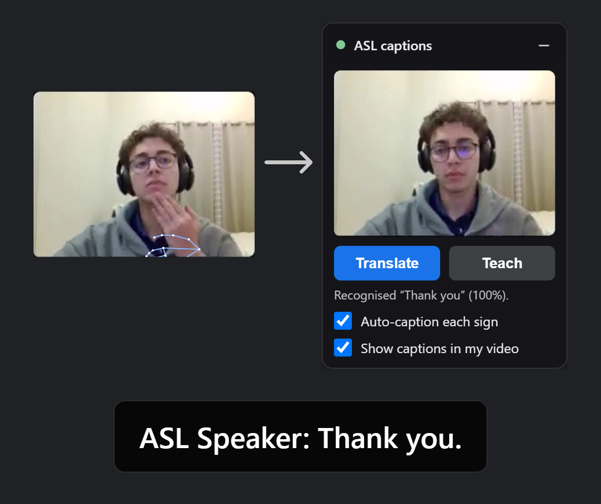
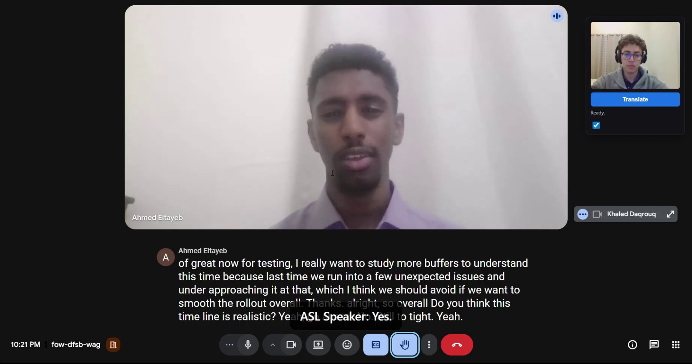
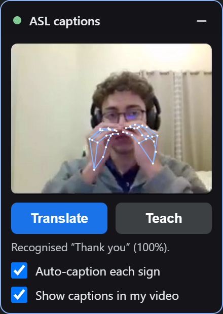
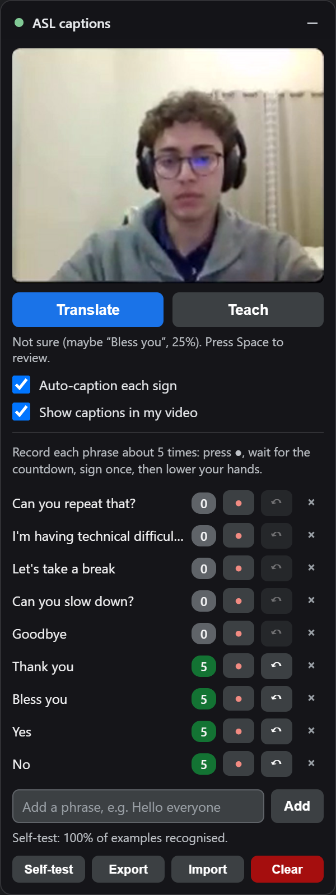

# ASL Meeting Captions

A Chrome extension that captions American Sign Language in Google Meet. You sign a phrase on camera, the extension recognizes it, and the caption is drawn into your outgoing video, so everyone in the call can read it without installing anything.

Demo video: https://youtu.be/MYHPJZgBtAI

<p align="center">
  
</p>

Me signing "thank you", and the caption it produces a moment later.

<a href="https://youtu.be/MYHPJZgBtAI"></a>

The same thing in a real Meet call from the demo. Ahmed is talking, I'm in the panel on the right, and "Yes" just came through as a caption.

## What it does

It starts with nine common meeting phrases and you can add your own. To teach it a phrase, you record yourself signing it about five times. A built-in self-test then estimates accuracy and tells you which phrases need more examples.

During a call you sign, then press Space (or turn on auto-captioning). If it isn't sure what you signed, it asks you to confirm or pick the right phrase, and your answer is saved as another training example, so it keeps adapting to how you sign.

Everything runs locally in the browser. Video, landmarks and training data never leave your machine, and there's no server or account.

<p align="center">
  
  &nbsp;&nbsp;
  
</p>

On the left, both hands tracked mid-sign. On the right, the Teach panel after recording five examples each of four phrases. For these screenshots I played my webcam footage from the demo into the extension as a fake camera, so it's my real signing going through the current version.

## How it works

MediaPipe's Hand Landmarker tracks 21 3D points on each hand, and a face detector finds the face. Each frame gets turned into a small feature vector: the hand's shape relative to the wrist, scaled by palm size, plus where the wrist is relative to the face. That makes it work whether you sit close to the camera or far from it.

Signs in ASL are movements, so the extension looks at whole motions instead of single poses. A sign starts when a hand moves or comes into view and ends when your hands go still or drop. The recorded motion is compared with your saved examples using dynamic time warping, which can match a fast and a slow version of the same sign. If a movement doesn't look like any phrase you taught, it gets a low confidence score and you're asked to confirm, so random gestures don't turn into wrong captions.

I didn't use a pretrained ASL model because the public datasets don't cover meeting phrases like these, and signing varies a lot between people. A few-shot model trained on one person's signing turned out to be more reliable, and it lets you pick your own vocabulary.

Getting the captions into the video took some work. The extension runs in three places:

- An extension page (`camera.html`) inside the Meet tab runs the camera and hand tracking. Meet's security policy can block WebAssembly in content scripts, so MediaPipe has to run here. It's a separate process, so tracking doesn't slow Meet down.
- The content script draws the panel and runs recognition. It talks to the camera page over a private `MessageChannel`.
- A small script in Meet's own page context wraps `RTCPeerConnection` and swaps the camera track on its way into the call for a copy with the caption drawn on each frame. Meet still sees its original track, so the self-view, background effects and screen sharing work as normal.

## Running it

You need Node.js 20+ and Chrome.

```bash
git clone https://github.com/KDaqrouq/fuzzy-goggles.git
cd fuzzy-goggles
npm install
npm run build
```

The build copies MediaPipe's WebAssembly files and downloads the hand and face models the first time, so it needs internet access.

Then open `chrome://extensions`, turn on Developer mode, click Load unpacked and pick the `dist` folder.

To use it:

1. Join a call on `meet.google.com` and allow the camera.
2. Open Teach, press the record button next to a phrase, sign it once after the countdown and lower your hands. Do this about five times per phrase, then run Self-test.
3. Sign, then press Space or Translate. You can also turn on "Auto-caption each sign".

After installing or reloading the extension, turn your Meet camera off and on once so the captions get added to your video. Export and Import in the Teach tab move your phrases and examples to another computer.

## Tests

```bash
npm test             # unit tests
npm run typecheck
npm run e2e          # end-to-end in Chrome (set CHROME_PATH if needed)
```

The unit tests use a simulated signer: a hand model that performs each sign at random speeds, positions and distances from the camera, with noise added to the landmarks. The end-to-end tests load the built extension into Chrome, run it against a stub Meet page with a fake camera, teach phrases through the real UI, and check that the captions show up in the video received over WebRTC.

## Limitations

- It recognizes single phrases from a vocabulary you teach it. It doesn't translate open-ended ASL, which would also need facial grammar and continuous signing.
- It's trained on one person. You can export your examples, but they aren't shared between users.
- Accuracy depends on lighting and on how consistently you record each phrase.

Things I'd like to add next: fingerspelling for names, needing fewer examples per phrase, text-to-speech, and Zoom and Teams support.

## Code layout

```
public/camera.html              camera page: webcam preview and hand tracking
src/content.ts                  panel UI, teach mode, captions
src/camera.ts                   sends landmarks from the camera page to the content script
src/vision.ts                   MediaPipe setup and per-frame features
src/pageHook.ts                 runs in Meet's page, adds captions to the outgoing video
src/recognition/                features, sign segmentation, DTW recognizer
src/phrases.ts, src/storage.ts  phrases, examples, settings, import/export
scripts/                        build, watch and end-to-end scripts
test/                           unit tests and the simulated signer
```

## Background

This started as a hackathon project that used hand-geometry rules for nine fixed phrases (the original planning docs are in [`docs/`](docs/)). I later rebuilt it around trainable, motion-based recognition and added captions that the whole call can see.

Made by [Khaled Al Daqrouq](https://github.com/KDaqrouq).
